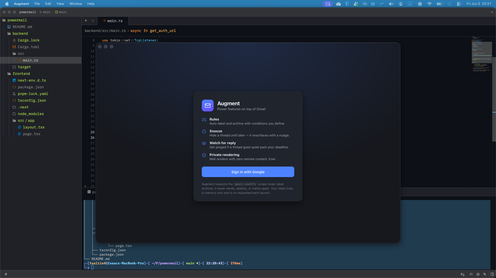

# Augment

A personal, single-user **Gmail augmentation** desktop client for macOS. It layers the
power features that other clients paywall — a **rules engine**, **snooze**,
**watch-for-reply**, and **native notifications** — directly on top of Gmail.

Gmail stays the source of truth. Augment never replaces it; it only adds a layer on
top, so a missed sync is always non-destructive. It talks to the Gmail REST API
directly from the TypeScript layer with an in-memory OAuth token, renders mail with
**zero remote content**, and uses a small Rust backend only for the background
scheduler, native notifications, and OAuth glue.

> Built with Tauri 2 · React + TypeScript (strict) · Rust. Free to run — Gmail API +
> local code only, no paid services.



---

## Table of contents

- [What it does](#what-it-does)
- [Architecture](#architecture)
- [Prerequisites](#prerequisites)
- [Google Cloud OAuth setup](#google-cloud-oauth-setup) ← **do this first**
- [Environment variables](#environment-variables)
- [Run & build](#run--build)
- [Using the four power features](#using-the-four-power-features)
- [Security model](#security-model)
- [Testing](#testing)
- [Known limitations](#known-limitations)
- [Project layout](#project-layout)

---

## What it does

| Feature | What it does | Where it lives |
| --- | --- | --- |
| **Inbox + reader** | Lists inbox threads, opens a conversation, renders the body sanitized. | TS (Gmail REST) |
| **Rules engine** | `From/To/Subject/Body` conditions (`contains`, `equals`, regex, …) → `add label` / `archive` / `mark read` / `star`. Changes show up in Gmail web. | TS |
| **Snooze** | Archives a thread + tags it `Augment/Snoozed`; at the chosen time it resurfaces in the inbox **and** fires a native notification. | TS + Rust scheduler |
| **Watch for reply** | Mark a thread "watch"; if no inbound reply arrives by the deadline, you get a native notification. | TS + Rust scheduler |
| **Private rendering** | Email renders as plaintext or HTML **stripped of all remote content**, inside a sandboxed iframe. No tracking pixels, no remote CSS, no scripts. | TS |

The scopes requested are limited to `https://www.googleapis.com/auth/gmail.modify`
— read, label, and archive. Augment **never** sends, permanently deletes, or marks
spam.

---

## Architecture

```
┌─────────────────────────── Tauri window (WKWebView) ───────────────────────────┐
│  React + TypeScript (strict)                                                    │
│    • Gmail REST client  (threads, labels, modify)  ── all mail data lives here  │
│    • Sanitizer (DOMPurify + sandboxed iframe CSP)                                │
│    • Rules engine (pure, unit-tested)                                            │
│    • UI: sign-in · inbox · reader · rules · snoozed · watching                  │
│            │ invoke()                                   ▲ events                 │
└────────────┼───────────────────────────────────────────┼───────────────────────┘
             ▼                                            │ "schedule-due"
┌──────────── Rust backend (narrow on purpose) ───────────┴──────────────────────┐
│   • OAuth loopback + PKCE  (start_oauth / refresh_access_token)                 │
│   • Scheduler tick (tokio) + JSON store in app-data  (schedule_add/list/remove) │
│   • Native notifications  (notify)                                              │
└────────────────────────────────────────────────────────────────────────────────┘
                 │ HTTPS (token exchange only)        │ HTTPS (all mail)
                 ▼                                     ▼
         oauth2.googleapis.com                 gmail.googleapis.com
```

**Why this split.** Mail logic is single-sourced in TypeScript (no IMAP, no Node
sidecar). Rust does only what a webview can't do well: bind a loopback port for the
OAuth redirect, hold a precise background timer, and post OS notifications. When a
snooze/watch comes due, Rust emits an event; the frontend performs the Gmail work and
asks Rust to fire the notification — so all Gmail logic stays in one place and the
notification is always a real macOS banner.

---

## Prerequisites

- **macOS** (Apple Silicon or Intel) with **Xcode Command Line Tools**.
- **Node.js ≥ 20** and npm.
- **Rust** (stable) via [rustup](https://rustup.rs).
- A **Google account** (your own) and a free **Google Cloud** project.

---

## Google Cloud OAuth setup

Augment uses your own OAuth **Desktop app** client. This is free and takes ~5 minutes.

1. **Create / pick a project** — <https://console.cloud.google.com/projectcreate>.
2. **Enable the Gmail API** — APIs & Services → Library → search **“Gmail API”** →
   **Enable**. (Direct: <https://console.cloud.google.com/apis/library/gmail.googleapis.com>.)
3. **Configure the OAuth consent screen** — APIs & Services → OAuth consent screen:
   - User type: **External**.
   - App name (e.g. *Augment*), your email as support + developer contact.
   - **Scopes:** you can leave the scope list empty here — Augment requests
     `.../auth/gmail.modify` at runtime. (If you add it, add **Gmail API → `.../auth/gmail.modify`**.)
   - **Test users:** add **your own Gmail address**. While the app is in *Testing*,
     only listed test users can sign in. (You do **not** need to publish/verify the
     app for personal use.)
4. **Create the OAuth client** — APIs & Services → Credentials → **Create credentials**
   → **OAuth client ID** → Application type: **Desktop app** → name it → **Create**.
   - A Desktop client automatically allows the **loopback redirect**
     (`http://127.0.0.1:<any-port>`), so there is nothing else to configure.
5. **Copy the Client ID and Client secret** into your `.env` (next section).

> **Testing-mode note.** Tokens issued to a *Testing* app expire quickly, but that is
> irrelevant here: Augment re-authenticates on every launch and never persists a
> refresh token, so there is no long-lived token to rot.

---

## Environment variables

Copy the example and fill in your client credentials:

```bash
cp .env.example .env
```

```dotenv
# .env  (gitignored — never commit this)
GOOGLE_CLIENT_ID=your-client-id.apps.googleusercontent.com
GOOGLE_CLIENT_SECRET=your-client-secret
```

These are read by the **Rust backend** at runtime (via `dotenvy`) only to perform the
OAuth token exchange. They are never bundled into the app and never written elsewhere.
In `npm run tauri dev` the `.env` at the project root is picked up automatically. For a
**packaged build**, either launch from a shell that has these vars exported, or place a
`.env` next to the executable.

---

## Run & build

```bash
npm install            # install JS deps (first time)

npm run tauri dev      # run the app with hot-reload (opens the window)
npm run tauri build    # produce a release .app + .dmg in src-tauri/target/release/bundle

npm run test           # TypeScript unit tests (Vitest)
npm run typecheck      # tsc --noEmit (strict)
cd src-tauri && cargo test   # Rust unit tests
```

A successful `npm run tauri build` produces:

- `src-tauri/target/release/bundle/macos/Augment.app`
- `src-tauri/target/release/bundle/dmg/Augment_0.1.0_aarch64.dmg`

> **macOS notifications:** OS notifications require a real `.app` bundle (a code-signed
> bundle identity). They fire reliably from `Augment.app` (the build output). Under
> `npm run tauri dev` the raw debug binary may not post Notification-Center banners —
> use the built app to see/demonstrate notifications.

---

## Using the four power features

After **Sign in with Google** (a browser tab opens — approve, then return):

### 1. Rules
Go to **Rules → New rule**. Example: *From contains `github.com`* → *Add label
`Augment/GitHub`* + *Archive*. Save, then **Run rules now**. Matching threads are
labeled/archived; open Gmail web to see the same labels. Toggle **Auto-apply on
refresh** to run enabled rules on every inbox refresh.

### 2. Snooze
Open a thread → **Snooze** → pick a time (there's a **20 seconds (demo)** preset). The
thread archives and tags `Augment/Snoozed` and leaves the inbox. When the timer fires
it reappears in the inbox (marked unread) **and** a macOS notification pops. See it
under **Snoozed** meanwhile; “Bring back now” un-snoozes early.

### 3. Watch for reply
Open a thread → **Watch for reply** → pick a deadline (again a **20 seconds (demo)**
preset). If no inbound reply arrives before the deadline, a macOS notification fires.
Track it under **Watching**.

### 4. Native notifications
Snooze and watch both fire real macOS Notification-Center banners (routed through the
Rust `notify` command). First run will ask for notification permission.

---

## Security model

- **Tokens in memory only.** The access token lives in the webview's memory; the
  refresh token lives in Rust process memory for the session and is **never written to
  disk**. Augment re-authenticates each launch (intentional — it sidesteps token rot).
- **OAuth with PKCE (S256)** over a loopback redirect with a CSRF `state` check.
- **No remote content, ever.** Mail rendering is defense-in-depth:
  1. **DOMPurify** removes scripts, event handlers, and dangerous tags, and hooks strip
     every remote-loading vector — `img/src`, `srcset`, `poster`, `background`, and
     `url(...)` in inline styles. Only `data:` images survive.
  2. The sanitized body is rendered inside a **sandboxed `<iframe srcdoc>`** whose own
     `<meta>` CSP is `default-src 'none'; img-src data:; …` — so even a sanitizer
     bypass cannot reach the network or run a script.
  3. The **app-level CSP** (`tauri.conf.json`) is the outermost backstop: `img-src
     'self' data:`, `connect-src` limited to the Gmail API hosts.
- **No destructive actions.** Only label/archive/mark-read/star are ever performed.
  Send, permanent delete, and mark-spam are out of scope by construction (the
  `gmail.modify` scope cannot do them).

**Verifying “no remote content” yourself:** open a marketing email with tracking
pixels, then in the Tauri webview devtools (right-click → Inspect) watch the **Network**
tab — opening the email issues **no** requests to image/tracker hosts. The reader also
shows a “🛡️ N remote items blocked” badge.

---

## Testing

- **TypeScript (Vitest, jsdom):** Gmail MIME parsing + base64url decoding, the email
  sanitizer (remote-content stripping, script removal, CSP doc), a full-pipeline
  integration test on a realistic tracking-laden email, and the rules engine —
  **48 tests**.
- **Rust (cargo test):** PKCE challenge derivation, auth-URL construction, redirect
  parsing, and the scheduler due-logic + JSON store roundtrip — **10 tests**.

**58 tests total, all passing.**

```bash
npm run test
cd src-tauri && cargo test
```

Captured output and screenshots live in [`docs/proof/`](docs/proof/). See also
[`docs/DECISIONS.md`](docs/DECISIONS.md) for the design log.

---

## Known limitations

- **Scheduler runs only while the app is open** (or tray-resident). There is no
  always-on daemon yet, so a snooze/watch fires when its time has passed *and the app is
  running*. Overdue items from a previous session fire on next launch. An always-on
  background daemon is deferred to v2.
- **macOS notifications need the built `.app`** (see Run & build).
- **Re-auth each launch** is by design (no persisted refresh token).
- Email **charset** handling assumes UTF-8 unless a part declares otherwise; exotic
  encodings may render imperfectly.
- Targets **macOS**; the OAuth browser-open has a portable fallback but the app is only
  tuned and tested for macOS.

---

## Project layout

```
augment/
├─ src/                        # React + TypeScript frontend
│  ├─ lib/
│  │  ├─ gmail/                # REST client, MIME parse, inbox loading  (+ tests)
│  │  ├─ sanitize/             # DOMPurify + sandboxed-iframe rendering  (+ tests)
│  │  ├─ rules/                # rule types, pure engine, apply layer    (+ tests)
│  │  ├─ features/schedule.ts  # snooze + watch behaviour
│  │  ├─ scheduler/api.ts      # bridge to Rust scheduler + events
│  │  ├─ auth/                 # OAuth command bridge + in-memory Session
│  │  ├─ store.ts              # rules/settings persistence (localStorage)
│  │  └─ time.ts               # duration presets + relative formatting
│  ├─ state/augment.tsx        # central app state / context
│  ├─ ui/                      # all components (sidebar, reader, rules, …)
│  └─ App.tsx · main.tsx · styles.css
├─ src-tauri/                  # Rust backend
│  └─ src/  lib.rs · oauth.rs · scheduler.rs · error.rs
├─ docs/                       # DECISIONS.md + proof/
├─ .env.example
└─ README.md
```
